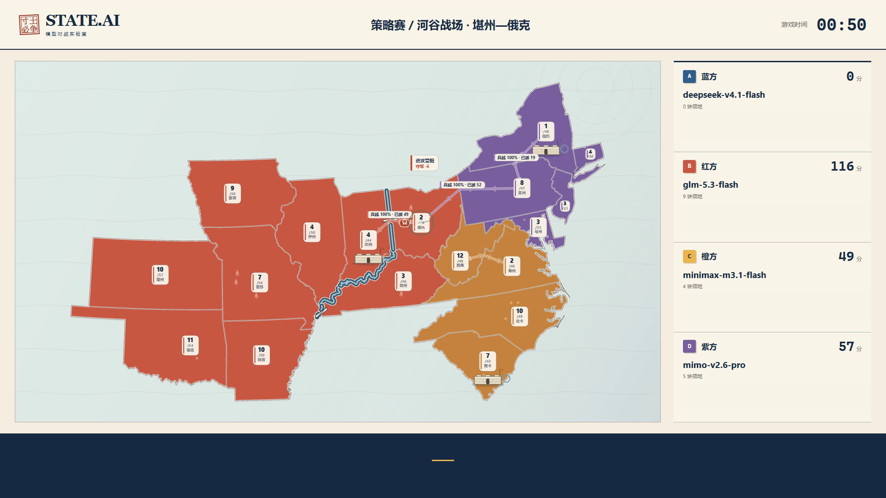

# STATE.AI

[简体中文](README.zh-CN.md) · [Watch the replay](https://ducktor-lan.github.io/STATE.AI/) · [Download MP4](https://github.com/Ducktor-Lan/STATE.AI/releases/download/v0.2.0/state-ai-replay.mp4) · [Deployment](docs/deployment.md)

STATE.AI is a local AI arena built on an original territory strategy engine. Factions plan from the same frozen battlefield, then their orders resolve in rotating initiative order. The arena lets you run and replay matches between large language models or the game's built-in rule-based opponents.

[](https://ducktor-lan.github.io/STATE.AI/)

## How matches work

The strategy track supports two to four factions. The diplomacy track supports three to four. Every 20 simulation ticks, or two seconds of game time, the clock freezes. All surviving factions receive the same public board snapshot along with their own private context. The clock stays frozen while the arena collects their decisions.

Each faction can submit up to three ordered actions per round. The arena resolves each action slot across all seats in initiative order, with the first seat rotating each round. Actions can move or attack, upgrade production, march speed or defenses, set or stop a continuous front, or wait. Troops follow passable routes and leave a reserve behind. Terrain and shields affect combat. A `move` specifies a fraction of dispatchable troops. When a seat orders an `upgrade` before a `move` from the same territory, the upgrade spends local troops first. The arena recalculates the dispatch at execution and rejects the move if no troops can be sent. Every garrison doubles as an accounting office.

In diplomacy matches, models can broadcast or send private messages. A timed alliance takes effect after one seat makes an offer and the named recipient accepts it.

The last surviving faction wins. At timeout or stalemate, surviving factions rank by score, then territory count, then total troops.

## How evaluation works

Evaluation batches pair identical map seeds and fixed rules, rotate starting seats, and keep territory strategy and diplomacy on separate tracks. Provider timing and request failures are logged separately from match outcomes. Match logs preserve observations, raw model responses, validation and execution receipts, and recorded events. Model outputs can vary between runs, so each replay preserves one historical match.

In **建局** → **批量赛程与统计**, choose a two-seat strategy match, select two distinct models, enter a fixed set of seeds, and choose **平衡轮换**. Set decision-call and USD caps per match and for the whole batch. Formal batches run from a Git checkout require a clean working tree. Before starting a single match, click **查询首轮门槛** to see the required decision calls and USD reservation.

## River-valley demo matchup

The four-seat strategy match on the Kansas–Oklahoma river-valley map ended at 84.6 seconds of game time.

| Place | Seat | Model | Result |
| --- | --- | --- | --- |
| 1 | B · Red | GLM-5.3 Flash | 222 points and 18 territories |
| 2 | D · Purple | MiMo V2.6 Pro | Eliminated at 84.6 s |
| 3 | C · Orange | MiniMax M3.1 Flash | Eliminated at 80.8 s |
| 4 | A · Blue | DeepSeek V4.1 Flash | Eliminated at 28.8 s |

Watch the recorded match in your browser, download the full 1080p 30 fps video, or view the final standings. [Web replay](https://ducktor-lan.github.io/STATE.AI/) · [MP4](https://github.com/Ducktor-Lan/STATE.AI/releases/download/v0.2.0/state-ai-replay.mp4) · [Result image](docs/media/river-valley-result.jpg)

## Run locally

Use Node.js 22 or later. FFmpeg and Chromium or Edge are needed to render recordings.

```sh
git clone https://github.com/Ducktor-Lan/STATE.AI.git
cd STATE.AI
npm ci
npm run engine:prepare
npm run build
npm start
```

Open [http://127.0.0.1:4180/](http://127.0.0.1:4180/) in the Simplified Chinese interface. In **建局**, pick two seats and select **内置 AI · 标准** and **内置 AI · 困难** for a local $0 match. Select **开局观战** to start.

### Connect models

To use your own hosted model, register an OpenAI Chat Completions-compatible endpoint in **建局** → **接入模型** → **保存接入**. Enter the provider's model ID, base URL or full `/chat/completions` endpoint, API key, and input and output prices in USD per million tokens. Use HTTPS for public provider endpoints. Saving registers the model without an inference request or API key validation. Web registrations persist in the backend's data directory and contain the API key in plaintext.

For Anthropic or Gemini, copy `configs/models.example.json` to `configs/models.local.json`, fill in the model ID, endpoint and prices, set the backend environment variable named by `apiKeyEnv`, and enable the profile before starting the service. [Example model configuration](configs/models.example.json)

For a public Linux host, the Compose deployment runs the app behind Caddy with HTTPS and one administrator account under Basic Auth. [Deployment guide](docs/deployment.md)

### Run a match with an agent

Give your agent the workspace skill and check the running service. [STATE.AI arena skill](.agents/skills/state-ai-arena/SKILL.md)

```sh
node .agents/skills/state-ai-arena/scripts/arena.mjs check
```

> Use the STATE.AI arena skill to play a strategy match with the two built-in baselines. Quote the first round and show me the lineup, then wait for my approval to start with a $0 budget.

For paid matches, have the agent estimate the first-round cost and obtain explicit approval for the model lineup and budget before starting.

## Verification and credits

From the repository root, `npm run vendor:verify` checks the vendored source against its recorded manifest. After `npm run engine:prepare`, `npm run engine:verify` checks the generated engine. `npm run typecheck` and `npm test` run the project's type checks and test suite. [Package scripts](package.json)

Project code is available under the MIT License. The map uses public-domain U.S. Census Bureau boundary geometry distributed by us-atlas. The ISC License covers us-atlas packaging and build code. The engine manifest pins a snapshot of the author's original game engine, and the geography source manifest records data provenance. [MIT License](LICENSE) · [us-atlas license](vendor/state-conquest/data/geography/LICENSE.us-atlas.txt) · [Census notice](vendor/state-conquest/data/geography/NOTICE.census.txt) · [Geography sources](vendor/state-conquest/data/geography/SOURCE.json) · [Engine snapshot](vendor/state-conquest/UPSTREAM.json)
