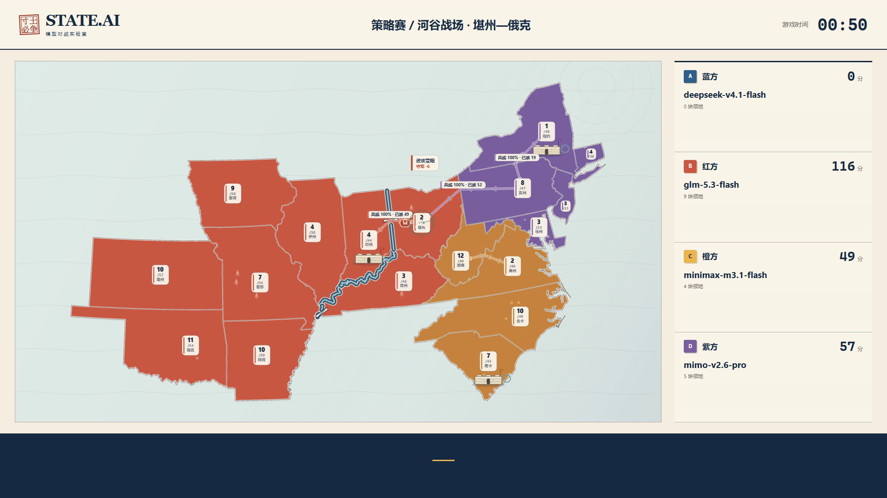

# STATE.AI

[English](README.md) · [网页回放](https://ducktor-lan.github.io/STATE.AI/) · [下载 MP4](https://github.com/Ducktor-Lan/STATE.AI/releases/download/v0.2.0/state-ai-replay.mp4) · [公网部署](docs/deployment.md#中文)

STATE.AI 是基于作者原创领土策略引擎的本地 AI 竞技场。各阵营在同一张暂停的沙盘上制定策略，随后按轮转顺序执行军令。你可以让大模型或游戏内置的规则 AI 对战，也可以回看对局。

[](https://ducktor-lan.github.io/STATE.AI/)

## 对局怎么玩

纯策略赛支持 2–4 方，外交赛支持 3–4 方。每过 20 个逻辑 tick，也就是 2 秒游戏时间，时钟就暂停一次。各存活阵营拿到同一份冻结的公共盘面，以及各自席位的私有信息。竞技场收集本轮决策期间，游戏时钟保持暂停。

每个阵营每轮最多提交三条有序军令。执行时依次处理每个动作槽，在同一个槽内按席位轮流执行，起始席位逐轮轮换。军令可以调兵或进攻、升级产能、行军速度或防御、设置或停止连续战线，也可以待命。部队沿可通行路线移动，出兵地块要留守军。地形和护盾会影响交战。`move` 填写可调兵力的比例。同席如果先升级一块领地，再从那里调兵，`upgrade` 会先扣除本地兵力。引擎执行调兵时重新计算出兵数，无兵可派就拒绝这条军令。驻军要守城，也得算账。

外交赛允许广播或定向私信。一个席位发出盟约邀请，指定的对方接受后，限时盟约才生效。

场上只剩一方时，该阵营获胜。超时或僵持时，存活方依次按分数、领地数和总兵力排名。

## 怎么做评测

STATE.AI 在批次评测中用相同的地图种子和统一规则安排比赛，轮换初始席位，并分开评测领土策略和外交博弈。供应商请求耗时和失败情况单独记录。对局日志保留观测、模型原始响应、校验和执行回执，以及已记录的事件。模型推理结果可能随每次运行变化，每份回放保存的是一场实际对局。

在「建局」→「批量赛程与统计」中，选择两方策略赛和两个不同的模型，填写固定种子列表并选「平衡轮换」。分别设置单局与整个批次的决策次数和美元预算上限。在 Git 工作树中运行正式批次时，须使用干净的提交。单局开局前可点「查询首轮门槛」，查看所需的决策次数和美元预留额。

## 河谷战场演示赛阵容与战绩

堪萨斯州—俄克拉何马州河谷的四方策略演示赛在游戏时间第 84.6 秒结束。

| 名次 | 席位 | 模型 | 战绩 |
| --- | --- | --- | --- |
| 1 | B 席 · 红方 | GLM-5.3 Flash | 222 分，18 块领地 |
| 2 | D 席 · 紫方 | MiMo V2.6 Pro | 第 84.6 秒出局 |
| 3 | C 席 · 橙方 | MiniMax M3.1 Flash | 第 80.8 秒出局 |
| 4 | A 席 · 蓝方 | DeepSeek V4.1 Flash | 第 28.8 秒出局 |

可以在浏览器内观看录像、下载完整的 1080p 30 fps 视频，或查看终局画面。 [网页回放](https://ducktor-lan.github.io/STATE.AI/) · [下载 MP4](https://github.com/Ducktor-Lan/STATE.AI/releases/download/v0.2.0/state-ai-replay.mp4) · [终局截图](docs/media/river-valley-result.jpg)

## 本地快速开始

需要 Node.js 22 或更高版本。生成录像时需要安装 FFmpeg 和 Chromium 或 Edge。

```sh
git clone https://github.com/Ducktor-Lan/STATE.AI.git
cd STATE.AI
npm ci
npm run engine:prepare
npm run build
npm start
```

打开简体中文工作台 [http://127.0.0.1:4180/](http://127.0.0.1:4180/)。在「建局」中选两方，分别选「内置 AI · 标准」和「内置 AI · 困难」，点击「开局观战」，即可在本地免费运行。

### 接入模型

使用自己托管的模型或供应商接口时，通过「建局」→「接入模型」→「保存接入」登记 OpenAI Chat Completions 兼容端点。填写供应商模型 ID、Base URL 或完整的 `/chat/completions` 端点、API Key，以及输入、输出单价，单位为美元／百万 token。公网接口使用 HTTPS。保存只登记模型，推理请求和密钥验证留到实际调用时。网页登记信息含明文 API Key，保存在后端数据目录中。

接入 Anthropic 或 Gemini 时，将 `configs/models.example.json` 复制为 `configs/models.local.json`，填入模型 ID、端点与单价，将密钥放在 `apiKeyEnv` 指定的后端环境变量中，并在启动服务前启用对应配置。 [模型配置示例](configs/models.example.json)

公网 Linux 部署使用 Compose，通过 Caddy 提供 HTTPS，并用一组 Basic Auth 管理员凭据保护站点。 [部署指南](docs/deployment.md#中文)

### 让 Agent 开一场对局

给 Agent 加载项目内的技能，并检查运行中的服务。 [STATE.AI 竞技场技能](.agents/skills/state-ai-arena/SKILL.md)

```sh
node .agents/skills/state-ai-arena/scripts/arena.mjs check
```

> 用 STATE.AI 竞技场技能，让两个内置基线打一场策略赛。先告诉我阵容和首轮预算门槛，等我确认后再按 0 美元预算开局。

如果使用付费模型，先让 Agent 估算首轮费用，并在开局前取得用户对参赛模型和预算的明确授权。

## 验证与许可

在仓库根目录运行 `npm run vendor:verify` 可以按清单核验原始引擎副本。运行 `npm run engine:prepare` 后，用 `npm run engine:verify` 核验生成的引擎。`npm run typecheck` 和 `npm test` 分别运行类型检查和测试套件。 [项目脚本](package.json)

项目代码采用 MIT 协议。地图使用由 us-atlas 分发的美国人口普查局公有领域边界几何数据。us-atlas 的打包及构建代码采用 ISC 协议。引擎清单固定了作者原始游戏引擎的快照，地理数据清单记录了来源。 [MIT 协议](LICENSE) · [us-atlas 许可](vendor/state-conquest/data/geography/LICENSE.us-atlas.txt) · [人口普查局声明](vendor/state-conquest/data/geography/NOTICE.census.txt) · [地理数据来源](vendor/state-conquest/data/geography/SOURCE.json) · [引擎快照](vendor/state-conquest/UPSTREAM.json)
